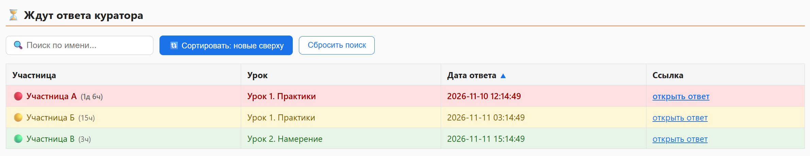
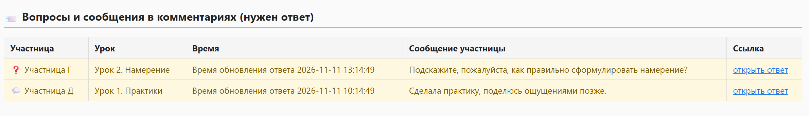
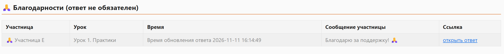

# 🍁 Festival Parser — автосборщик участниц куратора (GetCourse)

> Парсер закрытой админки GetCourse, который находит участниц конкретного куратора
> по маркеру-«листику», читает комментарии, классифицирует сообщения и собирает
> интерактивный HTML-отчёт со «светофором» срочности.


---

## 📌 Задача

Куратор фестиваля ведёт ~100 участниц, разбросанных по 15+ урокам на платформе
GetCourse. В «Ленте ответов» — **тысячи карточек** от всех кураторов. Найти своих
участниц вручную = листать страницы и искать оранжевый листик-маркер.

**Проблемы, которые решает скрипт:**
- ❌ Куратор не видит, кто из её участниц ещё не получил ответ.
- ❌ Вопросы в комментариях теряются (участница спросила → куратор не заметил).
- ❌ Нет приоритизации: кто ждёт ответа 2 дня, а кто — 2 часа.
- ❌ Ручной обход 15 уроков занимает 30–40 минут каждый день.

**Решение:** скрипт за ~2 минуты обходит все уроки, фильтрует по маркеру куратора,
читает комментарии, классифицирует их и генерирует три файла результата.

---

## ✨ Возможности

| Функция | Описание |
|---|---|
| 🔐 Авто-вход | Логин/пароль из `.env`; при протухшей сессии входит сам |
| 📚 Обход уроков | Цикл по списку уроков из `.env` (`GC_LESSON_IDS`), 15+ уроков за запуск |
| 🍃 Фильтр по маркеру | Находит участниц по title картинки-маркера куратора |
| 💬 Чтение комментариев | Определяет, кто написал последним: куратор или участница |
| 🚦 Светофор срочности | 🔴 >24ч · 🟡 12–24ч · 🟢 <12ч ожидания ответа |
| ❓ Классификация | Вопрос / сообщение / благодарность (серые, не требуют ответа) |
| 📊 HTML-отчёт | Интерактивные таблицы: сортировка, поиск, сворачиваемые тексты |
| 📁 CSV-выгрузка | `participants.csv` (все) + `waiting_reply.csv` (рабочий список) |
| 🛡️ Безопасность | Секреты в `.env`, профиль браузера в `.gitignore` |

---

## 🏗️ Как это работает

```
┌─────────────────────────────────────────────────────────┐
│                    python parse_answers.py run           │
└──────────────────────────┬──────────────────────────────┘
                           │
                           ▼
              ┌────────────────────────┐
              │  .env (логин/пароль)   │
              │  gc_profile/ (сессия)  │
              └───────────┬────────────┘
                          │
                          ▼
              ┌────────────────────────┐
              │  Playwright (headless) │
              │  Chromium + профиль    │
              └───────────┬────────────┘
                          │
            ┌─────────────┼─────────────┐
            ▼             ▼             ▼
     ┌──────────┐  ┌──────────┐  ┌──────────┐
     │ Урок 1   │  │ Урок 2   │  │ Урок N   │  ← цикл по GC_LESSON_IDS
     └────┬─────┘  └────┬─────┘  └────┬─────┘
          │              │              │
          ▼              ▼              ▼
     expand_list()  expand_list()  expand_list()   ← клики «Показать еще»
          │              │              │
          ▼              ▼              ▼
     collect_htmls() collect_htmls() collect_htmls() ← HTML-слепки
          │              │              │
          └──────────────┼──────────────┘
                         ▼
              ┌────────────────────────┐
              │  BeautifulSoup         │
              │  parse_cards()         │  ← карточки + маркеры + комментарии
              │  classify_comment()    │  ← вопрос / благодарность / сообщение
              └───────────┬────────────┘
                          │
            ┌─────────────┼─────────────┐
            ▼             ▼             ▼
   participants.csv  waiting_reply.csv  curator_report.html
   (все участницы)   (рабочий список)   (интерактивный отчёт)
```

---

## 🛠️ Стек технологий

| Технология | Роль |
|---|---|
| **Python 3.14** | Язык |
| **Playwright** | Управление браузером Chromium (headless) |
| **BeautifulSoup4** | Парсинг HTML-дерева |
| **python-dotenv** | Чтение секретов из `.env` |
| **csv / os / re / sys** | Стандартная библиотека |
| **HTML + CSS + JS** | Генерация интерактивного отчёта |

---

## 🚀 Установка и запуск

### 1. Клонировать / скачать проект

```bash
git clone https://github.com/antoxa3062-cpu/festival-parser.git
cd festival_parser
```

### 2. Создать виртуальное окружение

```bash
python -m venv .venv
# Windows:
.venv\Scripts\activate
# macOS/Linux:
source .venv/bin/activate
```

### 3. Установить зависимости

```bash
pip install -r requirements.txt
playwright install chromium
```

### 4. Создать файл `.env`

Скопируй файл-пример и заполни своими значениями:

```bash
# Windows (PowerShell):
Copy-Item .env.example .env
# macOS/Linux:
cp .env.example .env
```

```env
GC_LOGIN=your_email@example.com
GC_PASSWORD=your_password
GC_BASE_URL=https://your-school.getcourse.ru
GC_CURATOR=Имя Фамилия куратора
GC_TRAINING=Название тренинга
GC_MARKER_SRC=
GC_LESSON_IDS="
100000001   # Урок 1
100000002   # Урок 2
# 100000003  # отключённый урок
"
```

`GC_LESSON_IDS` — id уроков по одному на строку; строка с `#` в начале = отключённый урок.
```

### 5. Первый вход (сохранение сессии)

```bash
python parse_answers.py login
```

Скрипт откроет браузер, войдёт по кредам из `.env` и сохранит сессию в `gc_profile/`.

### 6. Рабочий запуск

```bash
python parse_answers.py run
```

Результат — три файла в папке проекта:
- `participants.csv` — все участницы куратора
- `waiting_reply.csv` — кому нужно ответить
- `curator_report.html` — интерактивный отчёт (открыть в браузере)

---

## 📁 Структура проекта

```
festival_parser/
├── parse_answers.py      # основной скрипт: парсинг + отчёты
├── make_demo.py          # генератор демо-отчёта (вымышленные данные)
├── requirements.txt      # зависимости для pip
├── pyproject.toml        # метаданные проекта (PEP 621)
├── .env.example          # шаблон переменных окружения (в Git)
├── .env                  # секреты и настройки (НЕ в Git)
├── .gitignore            # исключения для Git
├── LICENSE               # лицензия MIT
├── README.md             # этот файл
├── screenshots/          # скриншоты отчёта для README (в Git)
├── .venv/                # виртуальное окружение (НЕ в Git)
├── gc_profile/           # профиль браузера с сессией (НЕ в Git)
├── participants.csv      # результат: все участницы (НЕ в Git)
├── waiting_reply.csv     # результат: рабочий список (НЕ в Git)
├── curator_report.html   # результат: интерактивный отчёт (НЕ в Git)
├── demo_report.html      # результат: демо-отчёт (НЕ в Git)
└── debug_page.html       # слепок страницы для отладки (НЕ в Git)
```

---

## 📸 Скриншоты

### HTML-отчёт: шапка со «светофором»


### Блок «Ждут ответа куратора»



### Блок «Вопросы в комментариях»



### Блок «Благодарности»



---

## 🧠 Чему я научился в этом проекте

- **Playwright**: persistent context, headless-режим, авто-вход, ожидание элементов
- **BeautifulSoup**: CSS-селекторы, обход дерева тегов, извлечение атрибутов
- **Регулярные выражения**: поиск шаблонов в тексте (даты, id, маркеры)
- **Работа с файлами**: CSV с BOM для Excel, HTML-генерация, `.env`
- **Безопасность**: секреты вне кода, `.gitignore`, persistent-профиль
- **Архитектура**: разделение на функции, конфигурация через константы
- **Отладка**: слепки HTML, скриншоты, логирование в консоль
- **Генерация HTML+JS**: интерактивные таблицы без фреймворков

---

## 🔮 Планы развития

- [ ] Запуск по расписанию (Планировщик задач Windows / cron)
- [ ] Telegram-уведомления о новых «красных» (>24ч)
- [ ] Поддержка нескольких кураторов (параметр `--curator`)
- [ ] Экспорт в Excel с форматированием
- [ ] Веб-интерфейс (Flask/FastAPI) для просмотра отчёта
- [ ] Docker-контейнер для запуска на сервере

---

## ⚠️ Ограничения

- Скрипт работает с **конкретной платформой** (GetCourse) и её HTML-структурой.
  При обновлении платформы селекторы могут потребовать корректировки.
- Авто-вход не пройдёт капчу или 2FA — в таких случаях нужен ручной `login`.
- Пароль хранится в `.env` в открытом виде (стандартная практика для локальных
  скриптов; для продакшена рекомендуется vault/secret manager).

---

## 📄 Лицензия

MIT — используй как хочешь, но на свой страх и риск.

---

*Проект создан в рамках обучения Python-разработке. Первый реальный кейс
автоматизации рутинной задачи.*